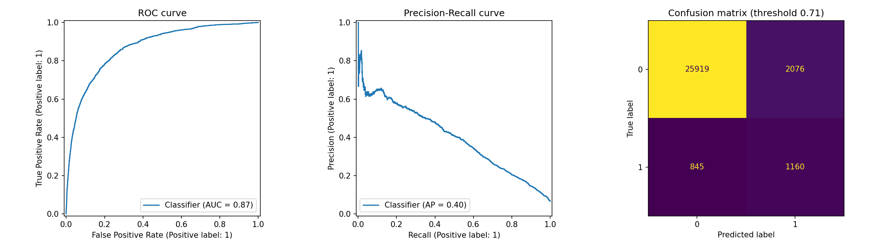
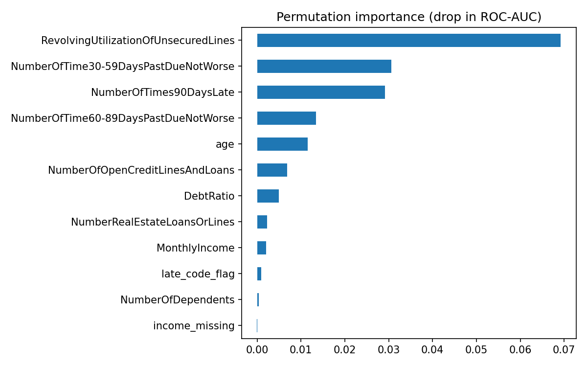

# Loan Default Prediction

An end-to-end machine learning project that predicts whether a borrower will become seriously delinquent (90+ days past due) within two years, built on the public *Give Me Some Credit* credit-scoring dataset (Kaggle, 2011). It covers data cleaning, handling extreme class imbalance, model comparison, threshold selection, evaluation and a small Streamlit app.

## Problem

A lender has to decide whether to approve a loan. Approving a borrower who later defaults is costly, but rejecting a good borrower also loses business. The goal is to rank borrowers by default risk and flag the risky ones.

- **Data:** 150,000 borrowers, 10 input features (age, income, debt ratio, credit utilization, past late payments and more)
- **Target:** `SeriousDlqin2yrs` (1 = 90+ days past due within 2 years)
- **Challenge:** only **6.7%** of borrowers default, so accuracy is misleading. A model that predicts "no default" for everyone scores about 93% accuracy and catches no defaulters. This project is judged on recall, precision, F1, ROC-AUC and PR-AUC instead.

The dataset is not included in this repository. Download `cs-training.csv` from the [Give Me Some Credit Kaggle competition](https://www.kaggle.com/c/GiveMeSomeCredit) to rerun the notebook.

## Approach

1. **Exploration:** checked distributions, missing values and impossible values.
2. **Cleaning**
   - Removed one row with an impossible age (under 18).
   - Replaced placeholder codes (96 and 98) in the three late-payment columns with 0 and added a `late_code_flag` feature. Borrowers with these codes defaulted **54.6%** of the time versus 6.6% for the rest, so the flag keeps useful information.
   - Added an `income_missing` flag and filled missing income (29,731 rows) and dependents (3,924 rows) with medians.
   - Capped extreme values of utilization, debt ratio and income at the 99th percentile.
3. **Leakage prevention:** used a stratified 80/20 train/test split first, then computed every median, cap and scaling statistic from the training set only.
4. **Models:** Logistic Regression baseline, Logistic Regression with class weights and with SMOTE, Random Forest, XGBoost, and a tuned XGBoost (randomized search with 3-fold stratified cross-validation, scored on PR-AUC).
5. **Threshold selection:** chose the decision threshold from cross-validated predictions on the training set only, using an assumed cost of 5:1 for a missed defaulter versus a wrongly flagged good borrower.
6. **Evaluation:** scored the final model on the untouched test set once.

## Results

All numbers are on the held-out test set (30,000 borrowers, 2,005 defaulters).

### Model comparison

| Model | ROC-AUC | PR-AUC |
|---|---|---|
| Logistic Regression (baseline) | 0.855 | 0.379 |
| Logistic Regression + class weights | 0.860 | 0.383 |
| Random Forest | 0.865 | 0.388 |
| XGBoost | 0.869 | 0.398 |
| **XGBoost (tuned)** | **0.870** | **0.400** |

- The baseline looked good on accuracy (93.6%) but caught only **17.2%** of defaulters.
- Class weights and SMOTE both lifted recall to about 76% at the default 0.5 cutoff, with nearly identical results (SMOTE: recall 0.759, ROC-AUC 0.859), so the simpler class-weight approach was used.
- Tree models gave a modest but consistent gain over Logistic Regression, and tuning added very little, which suggests the model is near what this data can support.
- Best XGBoost settings found by the randomized search: `n_estimators=600`, `learning_rate=0.02`, `max_depth=5`, `min_child_weight=10`, `subsample=0.8`, `colsample_bytree=0.6`, `gamma=0`. Cross-validated PR-AUC on the training set was 0.401, which matches the 0.400 on the test set, so there is no sign that the search overfitted.

### Final model: tuned XGBoost, threshold 0.71

| Metric (defaulter class) | Value |
|---|---|
| Recall | 0.579 (1,160 of 2,005 defaulters caught) |
| Precision | 0.358 |
| F1 | 0.443 |
| ROC-AUC | 0.870 |
| PR-AUC | 0.40 (random baseline is about 0.067) |

Confusion matrix: 25,919 true negatives, 2,076 false positives, 845 false negatives, 1,160 true positives.

Under the assumed 5:1 cost, this threshold lowers total cost by about 37% compared with flagging nobody (6,301 versus 10,025 cost units). The figure depends on that assumed ratio.



### What drives the model's predictions

Permutation importance (drop in test ROC-AUC when a feature is shuffled):

| Feature | Importance |
|---|---|
| RevolvingUtilizationOfUnsecuredLines | 0.0692 |
| NumberOfTime30-59DaysPastDueNotWorse | 0.0306 |
| NumberOfTimes90DaysLate | 0.0292 |
| NumberOfTime60-89DaysPastDueNotWorse | 0.0134 |
| age | 0.0115 |

Credit utilization and past late payments matter most. The three late-payment columns overlap with each other, so their individual scores understate how much the model relies on repayment history as a group. Permutation importance shows what the model uses, not what causes default.



## Run the app locally

```bash
git clone https://github.com/kishanrai2708/loan-default-prediction.git
cd loan-default-prediction
pip install -r requirements.txt
streamlit run app.py
```

Enter a borrower's details and the app returns a risk band (low, medium, high) and a risk score. The model is saved in XGBoost's JSON format (`xgb_model.json`) and the cleaning settings are in `meta.json`, so the app applies the same medians and caps as the notebook.

## Repository contents

| File | Purpose |
|---|---|
| `loan_default_prediction.ipynb` | Full analysis: cleaning, modelling, evaluation |
| `app.py` | Streamlit app |
| `xgb_model.json` | Trained XGBoost model |
| `meta.json` | Column order, imputation values, caps and threshold |
| `evaluation.png`, `feature_importance.png` | Charts used above |
| `requirements.txt` | Python dependencies |

## Limitations

- The dataset is from 2011 and from one lender, so results may not carry over to other populations or time periods.
- The XGBoost model was trained with class weighting, so its output is a **risk score for ranking**, not a true probability of default. A score of 0.71 does not mean a 71% chance.
- The threshold depends on an assumed 5:1 cost ratio. A real lender would set it from its own costs.
- Age is used as a feature here for demonstration. Real lenders must follow the fair-lending rules that apply where they operate, and no fairness analysis was done in this project.
- This is a learning project and not financial advice.

## Tech stack

Python, Pandas, NumPy, scikit-learn, XGBoost, imbalanced-learn, Matplotlib, Streamlit

## Author

Kishan Rai, B.Tech student at IIIT Una. [GitHub](https://github.com/kishanrai2708) · [LinkedIn](https://www.linkedin.com/in/kishan-rai-173389396)
